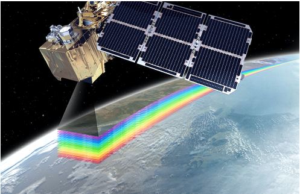
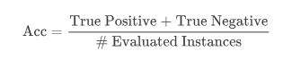

# Land Cover Classification from Satellite Data

Mini-competition 1 (Kaggle InClass — [`unina-machine-learning-24-25-mc-1`](https://www.kaggle.com/competitions/unina-machine-learning-24-25-mc-1), private/course-only). Recreated here from the competition's own Overview and Data pages, since that page requires course enrollment to view.

**Start**: Apr 24, 2025 &nbsp;·&nbsp; **Close**: May 8, 2025

## Description

In this Machine Learning challenge, the goal is to predict land cover from satellite observation data. Land cover refers to the physical material present on the surface of the Earth, such as forests, agricultural areas, urban zones, water bodies, snow, and more. It provides a physical description of the terrain, typically derived from satellite imagery.

Accurate land cover information is critical across a wide range of domains: it supports environmental monitoring, urban planning, natural resource management, disaster prevention, and climate modeling. Understanding how land is distributed allows for more informed decision-making in land management and environmental protection.

Participants in this challenge are tasked with developing a model that can automatically classify land cover types for each point in a given territory, using Earth observation data. For each point, the input features are derived from Sentinel-2 satellite data (L2A level, which includes atmospheric correction). Sentinel-2, operated by the European Space Agency (ESA), captures multispectral imagery, meaning it observes the Earth's surface across multiple wavelengths of the electromagnetic spectrum. These rich spectral features provide the information needed to distinguish between different land cover types.

*Image from: [eo-ins.org](https://eo-ins.org/?p=3405)*

## Contest Rules

Each student has to predict the class of land cover, realising one or more prediction models using data analysis and Machine Learning techniques. The performance measure to maximise is Accuracy. It is mandatory for the student who will achieve the best performance on the test dataset to discuss the process steps followed in order to reach the development of the final model. Each participant is free to use external tools (i.e. Weka, KNIME, MATLAB, etc.).

## Acknowledgements

We thank Dr. Antonio Elia Pascarella from Latitudo40 for providing the data.

## Evaluation

The evaluation metric for this competition is Accuracy — the percentage of correctly classified instances with respect to the total evaluated instances.

## Dataset Description

The data comes from two main sources, both available through platforms such as the [Microsoft Planetary Computer](https://planetarycomputer.microsoft.com/):

- **Input data** is obtained from the Sentinel-2 satellite at L2A level. Sentinel-2 provides multispectral images with a spatial resolution of up to 10 meters, and covers the entire Earth's surface every 5 days. Each point is a pixel in the image, representing an area of 10 m².
- **Reference data** (the target variable) is provided by the ESA WorldCover map, a global land cover product at 10-meter resolution. Each pixel is labeled with one of the following land cover classes:

  | Code | Class |
  |---|---|
  | 10 | Tree cover |
  | 30 | Grassland |
  | 40 | Cropland |
  | 50 | Built-up (Urban areas) |
  | 60 | Bare / sparse vegetation |
  | 80 | Permanent water bodies |

The features used for classification include:
- Spectral bands from B01 to B12, each sensitive to different surface properties (e.g. vegetation shows strong reflectance in the near-infrared spectrum).
- Derived spectral indices: **NDVI** (vegetation detection/health), **NDWI** (water bodies), **NDBI**/**IBI** (built-up areas), **ALBEDO** (surface solar reflectance).

The training set consists of 85,476 points; the test set includes 85,476 unlabeled instances.

## My solution

[`MC1-VItale.knwf`](MC1-VItale.knwf) — a KNIME workflow: normalization, a correlation-based feature filter, and a K-Nearest-Neighbors classifier (KNIME's K Nearest Neighbor node and Weka's IBk, cross-validated with X-Partitioner/X-Aggregator). Submission: [`mc_VITALE_2.csv`](mc_VITALE_2.csv).
