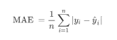

# Solar Irradiance Forecasting

Mini-competition 2 (Kaggle InClass — [`unina-machine-learning-24-25-mc-2`](https://www.kaggle.com/competitions/unina-machine-learning-24-25-mc-2), private/course-only). Recreated here from the competition's own Overview and Data pages, since that page requires course enrollment to view.

**Start**: May 10, 2025 &nbsp;·&nbsp; **Close**: May 23, 2025

## Description

Accurate solar irradiance forecasting is a cornerstone in advancing photovoltaic (PV) energy systems, which play a central role in the global transition to clean and sustainable energy. As the EU intensifies efforts to meet its climate targets, the expansion of PV installations — both large-scale and residential — has become increasingly vital. However, the intermittency of solar energy, driven by local meteorological conditions and diurnal cycles, poses significant challenges for reliable integration into the power grid.

This mini-contest focuses on a regression task where the goal is to predict solar irradiance for a specific location using a set of meteorological and physical variables. Since irradiance directly correlates with PV power output in a nearly one-to-one relationship, improving irradiance predictions effectively translates into improved production forecasts — useful for yield planning, storage management, and electricity market participation.

## Contest Rules

Each student has to predict the value of the solar irradiance realizing one or more regression models using data analysis and Machine Learning techniques. The performance measure to minimise is the Mean Absolute Error (MAE). Students are only allowed to use methods and models already discussed in the course.

## Acknowledgements

We thank Dr. Sofia Dutto from UniNa and Eng. Gabriele Piantadosi from ENEA for providing the data.

## Evaluation

The evaluation metric for this competition is the Mean Absolute Error (MAE) — a basic measure of fit, representing the average difference between predictions and their true values.

## Dataset Description

The dataset consists of samples collected from 10 different photovoltaic plants, acquired hourly starting from 2024. The training set contains data from 4 plants (`plant_1`–`plant_4`), for a total of 41,778 samples. The test set contains data from the remaining 6 plants, for a total of 32,243 instances.

Each sample is described by 47 features, detailed in [`description.pdf`](description.pdf) and [`infoMC.pdf`](infoMC.pdf). The acquisition timestamp is given in the `UTC` column, the `PLANT` column indicates the source plant, and the target value is the `Irr` column (irradiance).

## My solution

[`MC2-Vitale.knwf`](MC2-Vitale.knwf) — a KNIME regression workflow. Submission: [`MC2_Vitale.csv`](MC2_Vitale.csv).
