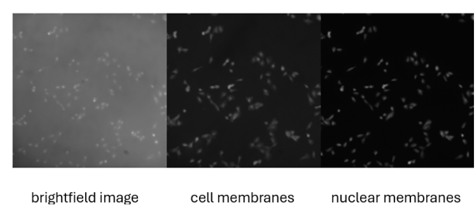
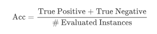
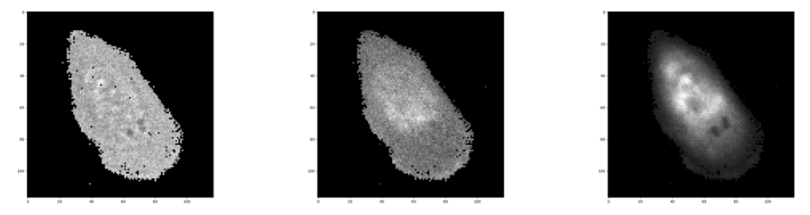

# Cancer Identification in Breast Cells

Mini-competition 3 (Kaggle InClass — `unina-machine-learning-24-25-mc-3`, private/course-only). Recreated here from the competition's own Overview and Data pages, since that page requires course enrollment to view.

**Start**: May 25, 2025 &nbsp;·&nbsp; **Close**: Jun 6, 2025

## Description

Participants are tasked with predicting the class of each breast cell (benign or malignant) based on images acquired using fluorescence microscopy — one of the most powerful imaging techniques for cellular analysis. This method uses fluorescent markers to selectively highlight specific cellular structures, enabling detailed visualization. Fluorescence microscopy images typically include multiple optical channels, each corresponding to a different fluorescent label, allowing simultaneous observation of multiple cellular components (e.g. nucleus and membrane) — valuable in cancer research and diagnostics for revealing subtle morphological and molecular differences between healthy and pathological cells.

Each student has to predict the class of each cell, realising one or more prediction models using data analysis and Machine Learning techniques.

## Evaluation

The evaluation metric for this competition is Accuracy — the percentage of correctly classified instances with respect to the total evaluated instances.

## Dataset Description

The dataset is provided by DICMAPI and comprises fluorescence microscopy images acquired from two human breast cell lines: **MCF10a**, representing non-tumorigenic (healthy) epithelial cells, and **MCF7**, a widely used model of breast cancer cells.

The training set consists of 239 acquisitions, the test set of 60. Since each acquisition contains multiple cells, a preprocessing step extracts individual cells, treating each as a separate image. For every cell, three distinct channels are provided:

- the **Membrane** (M)
- the **Nucleus** (N)
- the **Transmission** (T), i.e. the brightfield image

Each image is uniquely identified by an ID encoding both the acquisition number and the cell index (e.g. `000_1` = first cell from acquisition 000). All channels for each cell are stored in `.npy` files. The training set contains 6,798 images, the test set 1,721. **The classification task is binary: benign cells are labeled 0, malignant cells are labeled 1.**

A single extracted cell, close up, across its three channels:

## My solution

[`uninaml.ipynb`](uninaml.ipynb) — a PyTorch CNN (transfer learning, binary output head) trained on the three-channel cell images. Submission: [`submission_finale.csv`](submission_finale.csv).
